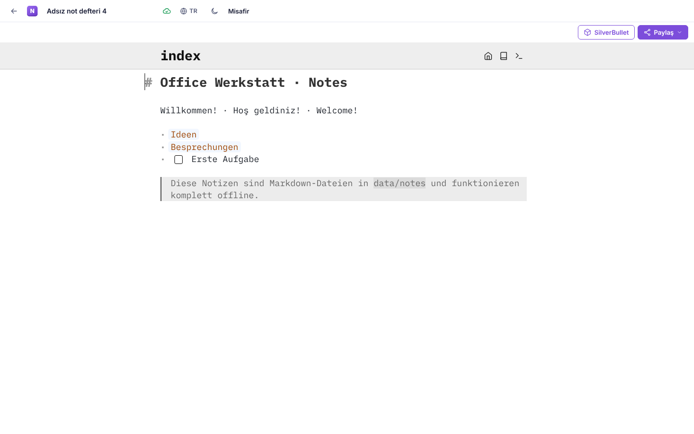

<p align="center">
  
</p>

<h1 align="center">Office Werkstatt</h1>

<p align="center">
  <b>Bütünleşik, internetsiz çalışan ofis paketi</b> – tarayıcıda, masaüstünde ve kendi sunucunuzda.<br>
  Word · Excel · Slide · Note · Draw · PDF Werkzeug — tek pencerede.
</p>

<p align="center">
  <a href="https://github.com/smyrna-pergamum/office-werkstatt/releases/latest"><b>⬇ Windows kurulum dosyası (çevrimdışı)</b></a>
  &nbsp;·&nbsp; <a href="#hızlı-başlangıç">Hızlı başlangıç</a>
  &nbsp;·&nbsp; <a href="#özellikler">Özellikler</a>
  &nbsp;·&nbsp; <a href="#english">English</a>
  &nbsp;·&nbsp; <a href="#deutsch">Deutsch</a>
</p>

<p align="center">
  
  
  
  
</p>


## Özellikler

| Araç | Yerleşik düzenleyici | Tam motor (yerleşik) |
|---|---|---|
| **Word Werkzeug** | Zengin metin, stiller, tablo, resim, içindekiler, dipnot, bul/değiştir, sayfa düzeni, `.docx` içe/dışa aktarma | **Word Werkzeug Pro** |
| **Excel Werkzeug** | Formül motoru (SUM / SUMME / TOPLA / SUMA / SOMME…), biçimler, koşullu biçim, grafik, sıralama/filtre, çoklu sayfa, `.xlsx` / `.csv` | **Excel Werkzeug Pro** |
| **Slide Werkzeug** | Düzenler, temalar, şekiller, resim, geçişler, sunum modu (F5), `.pptx` içe/dışa aktarma, PDF / HTML | **Slide Werkzeug Pro** |
| **Note Werkzeug** | Defter → bölüm → sayfa, etiketler, kalem/mürekkep, toplantı şablonu | **SilverBullet** (Markdown wiki) |
| **Draw Werkzeug** | El çizimi tarzı beyaz tahta, şekiller, oklar, metin, kitaplık, `.excalidraw`, PNG / SVG | **Excalidraw** |
| **PDF Werkzeug** | Düzenleme, OCR, imzalama, koruma, dönüştürme | **PDF Werkstatt** (kırmızı sürüm) |

- **Office tarzı arayüz:** başlık çubuğu, sekmeler (Datei / Start / Einfügen …), şerit, Kommentare, Aufholen, Bearbeiten / Anzeigen, Teilen, Datei arka planı, otomatik kayıt, Alt+M komut araması.
- **Ana sayfa:** karşılama alanı, oluşturma butonları, son dosyalar, hızlı başlangıç, sürükle-bırak yükleme, Ctrl+K arama.
- **Kitaplık:** Dosyalarım, şablon galerisi, Paylaşılanlar, Favoriler, Çöp kutusu (geri yükleme), yedekleme / geri yükleme.
- **5 dil:** Türkçe, Deutsch, English, Español, Français — dil seçimi editör menülerini ve tam motorları da değiştirir.
- **Açık / koyu tema**, responsive tasarım (masaüstü, tablet, mobil).
- **Eigene App:** kendi web uygulamanızı *Ayarlar → Eigene App* altına ekleyin.
- **Tamamen çevrimdışı:** hiçbir CDN veya harici istek yok. Yalnızca *Diktieren* (sesle yazdırma) tarayıcının çevrimiçi hizmetini kullanır; butonun yanında uyarı vardır.

<table>
<tr><td></td><td></td></tr>
<tr><td></td><td></td></tr>
<tr><td></td><td></td></tr>
</table>

## Hızlı başlangıç

### 1 · Windows masaüstü uygulaması
[Releases](https://github.com/smyrna-pergamum/office-werkstatt/releases/latest) sayfasından `Office-Werkstatt-Setup-<sürüm>.exe` dosyasını indirip çalıştırın.
Kurulum **internet ve yönetici hakkı gerektirmez**; masaüstü kısayolu, başlat menüsü kaydı ve
`.docx .xlsx .pptx .pdf .csv .md .excalidraw` için “Birlikte aç → Office Werkstatt” ekler. Belgeler `%APPDATA%\Office Werkstatt` içinde saklanır.

### 2 · Sunucu (ekip / intranet) — Node.js 18+, bağımlılık yok
```bash
node server/server.js                 # http://localhost:8080
# Windows: start-windows.bat   ·   Linux/macOS: ./start.sh
PORT=9000 DATA_DIR=/srv/ow OW_USER=ekip OW_PASS=gizli node server/server.js
docker compose up -d                  # veriler ./data içinde
```
Sunucu modunda herkes aynı dosyaları görür; Note Werkzeug için SilverBullet otomatik başlar (`/sb/`).
Tarayıcıda adres çubuğundaki **Yükle** simgesiyle uygulama olarak (PWA) kurulabilir.

### 3 · Kurulumsuz
`public/index.html` dosyasına çift tıklayın — belgeler tarayıcıda (IndexedDB) saklanır.

## Derleme

```bash
cd desktop && npm install
npm start                 # geliştirme
npm run dist:win          # → dist/Office-Werkstatt-Setup-<sürüm>.exe (yerel NSIS, Wine gerekmez)
npm run dist:linux        # AppImage    ·    npm run dist:mac → .dmg
```

Tam motorlar `public/engines/` içinde derlenmiş olarak gelir. Yeniden derlemek için (Rust ≥ 1.95, `wasm32-unknown-unknown`, `wasm-bindgen-cli 0.2.129`):
```bash
node scripts/fetch-engines.js            # tüm motorlar
node scripts/fetch-engines.js word pdf   # yalnızca seçilenler
```

## Klasör yapısı
```
public/              web uygulaması (index.html, css/, js/, assets/, manifest, service worker)
  js/editors/        word · excel · slide · note · draw · pdf
  js/zip.js          OOXML motoru (.docx/.xlsx/.pptx okuma, .docx/.xlsx/.pptx yazma)
  js/i18n.js         5 dilli sözlük
  engines/           tam motorlar + engines.js + apps.js (Eigene App)
engines-bin/         SilverBullet sunucu dosyaları (Windows, Linux)
server/server.js     bağımlılıksız Node sunucusu + REST API (/api/files, /api/engines, /sb/)
desktop/             Electron kabuğu + çevrimdışı NSIS kurulum betiği
scripts/             motor kurulum / derleme betikleri
```

## Not motoru değerlendirmesi
| | Memos | SilverBullet | AFFiNE |
|---|---|---|---|
| Tür | Kısa not / zaman akışı | Markdown wiki & not defteri | Doküman + beyaz tahta |
| Boyut | ~30 MB | ~40–55 MB tek dosya | yüzlerce MB |
| Çevrimdışı | sunucu gerekir | sunucu + PWA çevrimdışı senk. | yerel öncelikli, çok ağır derleme |
| Karar | farklı amaç | **seçildi, yerleşik** | çıkarıldı |

---

## English
**Office Werkstatt** is an integrated, fully offline office suite for the browser, the desktop (Windows/macOS/Linux) and your own server:
Word, Excel, Slide, Note, Draw and PDF tools with an Office-style ribbon, 5 interface languages (TR/DE/EN/ES/FR), light/dark theme and
responsive layout. Download the offline Windows installer from **Releases**, or run `node server/server.js`.

## Deutsch
**Office Werkstatt** ist eine integrierte Office-Suite, die komplett ohne Internet läuft – im Browser, auf dem Desktop und auf dem eigenen Server:
Word-, Excel-, Slide-, Note-, Draw- und PDF-Werkzeug mit Menüband im Office-Stil, 5 Sprachen, hellem/dunklem Design und responsivem Layout.
Den Offline-Installer für Windows gibt es unter **Releases**; Server-Start mit `node server/server.js`.

## Lisans
Office Werkstatt: [MIT](LICENSE) © Süleyman Akbulut.
Yerleşik motorlar kendi lisanslarını korur; lisans metinleri ilgili klasörlerdedir:
`public/engines/word|excel|slide/LICENSE-*` (MIT veya Apache-2.0), `public/engines/pdf/LICENSE` (AGPL-3.0),
`engines-bin/silverbullet/LICENSE.md` (MIT), Excalidraw ve React (MIT).
