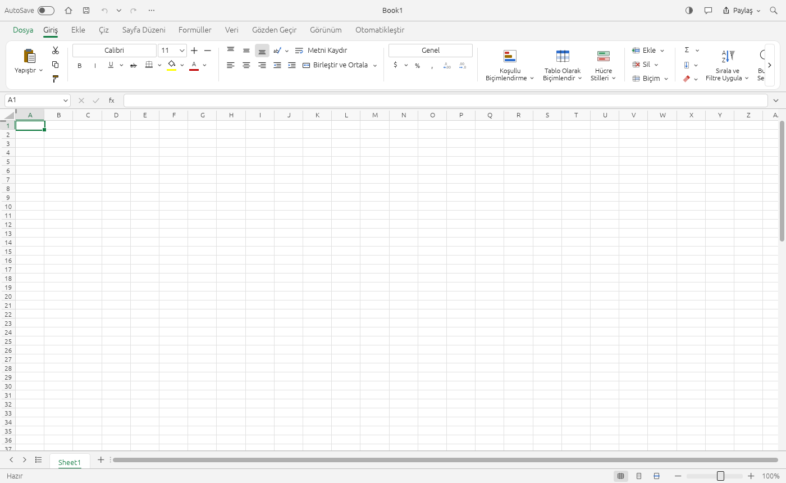
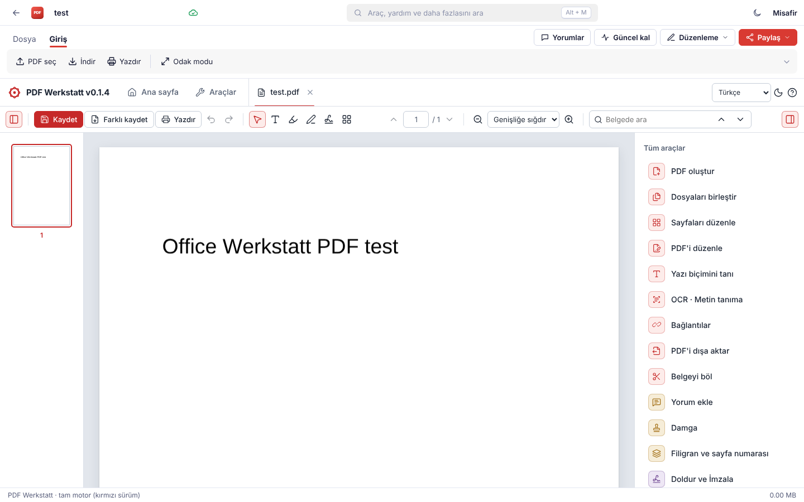
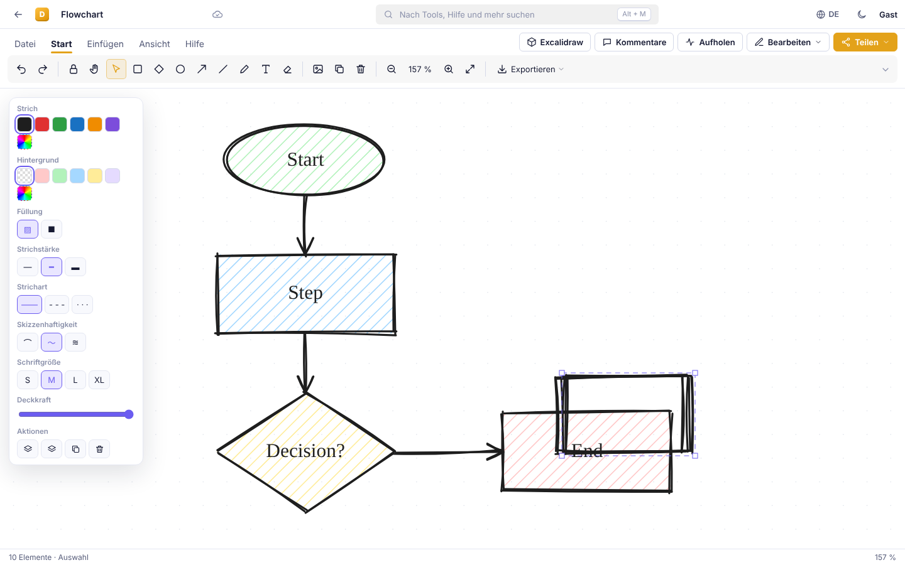

<p align="center">
  
</p>

<h1 align="center">Office Werkstatt</h1>

<p align="center">
  <b>An integrated office suite that works fully offline</b> – in the browser, on the desktop and on your own server.<br>
  Word · Excel · Slide · Note · Draw · PDF · Design · Form · <b>AI</b> Werkzeug — in one window, with a built-in AI agent.
</p>

<p align="center">
  <a href="https://github.com/smyrna-pergamum/office-werkstatt/releases/latest"><b>⬇ Windows installer (offline)</b></a>
  &nbsp;·&nbsp; <a href="#quick-start">Quick start</a>
  &nbsp;·&nbsp; <a href="#features">Features</a>
  &nbsp;·&nbsp; <a href="#ai-agent-ai-werkzeug">AI agent</a>
  &nbsp;·&nbsp; <a href="#türkçe">Türkçe</a>
  &nbsp;·&nbsp; <a href="#deutsch">Deutsch</a>
</p>

<p align="center">
  
  
  
  
</p>


## Features

| Tool | Editor |
|---|---|
| **Word Werkzeug** | **Word Werkzeug Pro** (full engine) — documents are stored in the library as `.docx` |
| **Excel Werkzeug** | **Excel Werkzeug Pro** (full engine) — `.xlsx`, multiple sheets, formulas |
| **Slide Werkzeug** | **Slide Werkzeug Pro** (full engine) — `.pptx`, built-in **OpenDocument** (`.odp .otp .fodp .odg`) save and open, interface in 5 languages |
| **Note Werkzeug** | OneNote-style: notebook → section → page, tags, pen/ink, meeting template, **calendar** (month view, event ↔ page links, `.ics` import/export) |
| **Draw Werkzeug** | Notes and brainstorming board (infinite canvas): note cards, sticky notes, shapes, connectors, mind maps, frames, pen; classic ribbon; templates; PNG / SVG / `.excalidraw` |
| **PDF Werkzeug** | **PDF Werkstatt** (red edition): editing, OCR, signing, protection, conversion |
| **Design Werkzeug** | Canva-style design studio: social media posts, posters, flyers, magazine and book covers, brochures (bi-fold, Z-fold, roll fold), invitations, business cards, new year / birthday / greeting cards, stickers, certificates, video. 17 templates, 16 embedded fonts, brand kit, frames, QR codes, pages, animation; stock photos / illustrations / icons / music (Openverse, Iconify, Pexels, Pixabay, Unsplash, Freesound, Jamendo); PNG, JPG, SVG, PDF, print PDF (bleed + crop marks), video with music |
| **AI Werkzeug** | Built-in AI agent: side panel in every Werkzeug and a full page; works in the document, researches on the internet, creates new documents (see [AI agent](#ai-agent-ai-werkzeug)) |
| **Form Werkzeug** | Drag-and-drop form builder, unlimited questions, date + time picker, image and text blocks, welcome screen, header image, colour / background / frame, preview/kiosk, link + QR code, answers → Excel Werkzeug, `.xlsx` / `.csv` |

When the Pro engines are installed, Word / Excel / Slide open directly in them (there is no separate “simple view”).
The engine's Save command (Ctrl+S) writes the document to the Office Werkstatt library; it is also saved automatically
when closing, when the language changes and after a pause in editing. Without the engines, the built-in editors are used.

- **Office-style interface:** title bar, tabs (File / Home / Insert …), ribbon, comments, catch up, editing / viewing, share, File backstage, autosave, Alt+M command search.
- **Dashboard:** welcome area, create buttons, recent files, quick start, drag-and-drop upload, Ctrl+K search.
- **Library:** My files with folders, template gallery, Shared, Favourites, Trash (restore), backup / restore.
- **5 languages:** English, Deutsch, Türkçe, Español, Français — the language switch also changes the editor menus, the full engines (Word, Excel, Slide) and PDF Werkstatt.
- **Light / dark theme**, responsive layout (desktop, tablet, mobile).
- **Own app:** add your own web app under *Settings → Own app*.
- **Fully offline:** no CDN and no external requests. The internet is only used when you ask for it: the AI agent's internet research (can be switched off in Settings), stock media and dictation.

<table>
<tr><td></td><td></td></tr>
<tr><td></td><td></td></tr>
<tr><td></td><td></td></tr>
</table>

## AI agent (AI Werkzeug)

The **AI** button in the title bar of every Werkzeug opens the agent panel at the side; the **AI Werkzeug** card on the dashboard opens it as a full page.
The panel is one **agent**: you say what you want, the agent does the work.

**AI engines** (Settings › AI)
- **Built-in engine** ([llama.cpp](https://github.com/ggml-org/llama.cpp)) – no Ollama or other program needed. Download a model from the list with one click (Qwen 2.5 1.5B / 7B / 14B, Llama 3.2 3B); it uses the graphics card when there is one, otherwise the CPU. Works completely offline.
- **Ollama** (on the same computer, `http://127.0.0.1:11434`).
- **Any API in the OpenAI standard** (`/v1/chat/completions`: OpenAI, OpenRouter, Mistral, Groq, LM Studio, vLLM …) – with your own API key.

**Agent Bridge – how the agent works** (design: [`agent-bridge/`](agent-bridge/), in the app: `public/js/agent-bridge.js`)

```
request → AI model → reading tools (document, library, internet) → change PLAN
        → validation (allowed tools, schema) → preview → approval → one transaction → undo
```

- **Reads:** the open document, the files in the library and the **internet** (search + reading pages; sources are given as links) – on its own.
- **Plans:** it never touches the document directly; all changes are prepared as one plan. Only the tools in the open Werkzeug's tool registry can be used, and arguments are checked against each tool's schema; `$result:N` passes the result of an earlier step (e.g. the id of a new slide) to a later one. At most 50 steps.
- **Preview and approval:** the plan is shown step by step in the panel – *Apply* / *Reject* (can be switched off in Settings).
- **One transaction:** an approved plan is applied in one go; if a step fails, the document returns to its state before the plan. If the document was changed by hand after the preview, the plan is not applied.
- **Undo:** a finished plan is undone in one step with *Undo the agent's changes*.
- **Werkzeuge:** Word (writing, styles, every ribbon command), Excel (cells, formulas), Slide (slides, texts), Note, Draw (sticky notes, mind maps), Design, Form; new Word / Excel / Slide / Note / Form documents in the library.

**Internet research:** on by default (switch it off in the panel under **+ › Internet research** or in Settings).
Searches go to your own **SearXNG** server (optional), Bing, DuckDuckGo and Wikipedia in that order – if one does not answer, the next is tried.
Requests go through the Office Werkstatt server (`/api/ai/*`); local network addresses are blocked, and text from web pages is treated as data, never as instructions.
API keys are only stored in the browser / desktop app and are only sent to the configured API.

## Design Werkzeug

Canva-style design studio: a classic ribbon at the top like the other tools, on the left the *Templates · Elements · Text · Photos · Illustrations · Icons · Audio · Uploads · Brand · Layers · Sources* panel, the page in the middle and the page strip at the bottom.

- **Formats:** Instagram / Facebook / LinkedIn / X / YouTube / Pinterest, posters A3–A1, flyers A4–A6, magazine, book cover (with spine), bi-fold / Z-fold / roll-fold brochure, invitation, folded card, postcard, business card, sticker, certificate, video 16:9 and 9:16, custom size. Print formats show 3 mm bleed, safe area and fold lines.
- **Export:** PNG, JPG, SVG, standard PDF, **print PDF** (300 dpi, bleed, crop marks, TrimBox/BleedBox), **video** with page animations and music (MP4/WebM).
- **Stock media:** Openverse and Iconify work without a key; free API keys for Pexels, Pixabay, Unsplash, Freesound and Jamendo are entered under *Insert → Stock sources*. In server mode the keys stay on the server in `data/stock-keys.json`, media is fetched through `/api/stock/media` and embedded in the design (so it also shows offline later). The licence/source of every medium used is listed in the *Sources* panel.
- Canvas engine: [Fabric.js](http://fabricjs.com) 5.3 (MIT). Fonts: OFL-licensed via Fontsource (see `public/fonts/LICENSE.txt`).

## Form Werkzeug

Build the form by drag and drop (unlimited questions; images, text blocks, date/time picker, welcome screen, header image, frame and background colour) and click **Create** – you get a single-file HTML form page. The answers are collected automatically in an **Excel Werkzeug spreadsheet**.

| Use | How to share | Where the answers go |
|---|---|---|
| **Server** (internet / local network) | Link `https://<server>/f/<id>` and **QR code** – no password, people only see this form | To the server; the Excel sheet updates itself with every new answer |
| **HTML file** (e.g. on your website) | Put the page wherever you like; if a *server address* is set, it sends there (CORS enabled) | To the server – if it can't be reached, saved on the device and retried at the next start |
| **Kiosk** (tablet / laptop, offline) | Leave the page open on the device; the form resets after every answer | On the device; *Export answers* at the bottom → *Answers → Import* |
| **E-mail fallback** | Without a server, a “Send by e-mail” button appears | Paste the e-mails you receive into *Answers → Import* |

Server endpoints: `GET /f/<id>` (public page) · `POST /api/forms/<id>/responses` (public, validated, 30 requests per minute per IP – `OW_FORM_RATE`) · `GET/DELETE /api/forms/<id>/responses` and `PUT/GET/DELETE /api/forms/<id>/publish` (team login required). Data in `data/forms/`.

<table><tr><td></td><td></td></tr></table>

## Quick start

### 1 · Windows desktop app
Download `Office-Werkstatt-Setup-<version>.exe` from the [Releases](https://github.com/smyrna-pergamum/office-werkstatt/releases/latest) page and run it.
Setup needs **no internet and no administrator rights**; it adds a desktop shortcut, a Start menu entry and
“Open with → Office Werkstatt” for `.docx .xlsx .pptx .pdf .csv .md .excalidraw`. Documents are stored in `%APPDATA%\Office Werkstatt`.

### 2 · Server (team / intranet) — Node.js 18+, no dependencies
```bash
node server/server.js                 # http://localhost:8080 — this computer only (127.0.0.1)
# Windows: start-windows.bat   ·   Linux/macOS: ./start.sh
HOST=0.0.0.0 OW_USER=team OW_PASS=secret node server/server.js     # share on the network: login required
OW_USER=team OW_PASS=secret docker compose up -d                    # data in ./data
```
**Security:** by default the server only listens on `127.0.0.1`. On a network address (`HOST=0.0.0.0` etc.) it does **not start**
without `OW_USER` / `OW_PASS` — otherwise everyone on the network could read and change every document. On a network, always run it
behind an HTTPS reverse proxy (Caddy, nginx, Traefik); basic authentication sends the password in plain text. In local mode, access from other
sites through domain names pointed at `127.0.0.1` (DNS rebinding) is blocked. HTML in documents is sanitised every time it is shown
(scripts, event handlers and `javascript:` links don't run).
In server mode everyone sees the same files.
In the browser it can be installed as an app (PWA) with the **Install** icon in the address bar.

#### Control center (server administration)
Administrators find **Control center** in the sidebar (`#/admin`, all 5 languages). In the desktop app and on a local server
without a login, the person at the computer is the administrator.

| Tab | What it does |
|---|---|
| **Overview** | status, uptime, documents, data size and free disk space, requests per minute, errors/warnings of the last 24 h, active users, last backup, built-in AI engine; refreshes itself |
| **Checks** | health checks (Node version, writable data folder, disk space, unreadable documents, interrupted saves, orphaned form data, old trash, backups, login and network exposure, file permissions, engines, converter, memory) with one-click fixes |
| **Users** | several accounts with roles — **admin** (everything), **editor** (documents and forms), **viewer** (read only); add, change role, set password, disable, delete. Everybody can change their own password in the user menu |
| **Sharing** | every document with owner and the people it is shared with; per person: owns / shares / receives. Change any share, give a document a new owner, hand over all documents of a person, stop every share with a person, give older documents (from before accounts) an owner |
| **Maintenance** | backups (create, download, upload, restore *merge* or *replace* – a safety backup is always made first, delete), empty the trash for all users, repair (unreadable files → `data/quarantine/`, nothing is deleted) |
| **Logs** | server log with categories (files & sharing, logins & accounts, administration, requests, problems), level filter, search, live view and download per day |
| **Sessions** | who used the server in the last 24 hours: user, role, address, browser, requests |

**Sharing between users:** with accounts, a new document belongs to the person who creates it and is **private**. In the file menu
(and the editor's *Share* button) *Share with people…* gives single people *can view* or *can edit*, or everybody on the server.
Shared documents appear under **Shared** (“from ali”); people with *can view* open them read-only, only the owner can share, move,
trash or delete them, and anybody can *Make my own copy*. Documents from before accounts existed have no owner and stay visible
to everybody until an admin gives them one. Sharing changes, owner changes, creating/renaming/deleting, and every time someone
opens or edits another person's document are written to the log (category *Files & sharing*).

Accounts are stored in `data/users.json` (scrypt password hashes, file mode 600). `OW_USER`/`OW_PASS` still work and are always an
admin; as soon as **any** account exists, everybody has to sign in. After 10 wrong passwords in 15 minutes an address has to wait.
Admin requests need the header `X-OW-Request: 1` and the server's own origin (CSRF protection). `GET /api/health` answers without a
login for monitoring (the Docker image uses it as `HEALTHCHECK`).

**Command line** (`server/owctl.js`, same `DATA_DIR` / `HOST` / `PORT` as the server, works while it runs):
```bash
npm run doctor                                     # = node server/owctl.js doctor [--fix] [--json]  (exit code 1 on problems)
node server/owctl.js user add anna --role admin    # password is asked (or OW_NEW_PASS / stdin)
node server/owctl.js user list | passwd <name> | role <name> <role> | disable <name> | enable <name> | remove <name>
node server/owctl.js backup [list]   ·   node server/owctl.js restore <file> [--replace]
node server/owctl.js trash empty --older-than 30   ·   node server/owctl.js repair
node server/owctl.js logs --level warn -n 100 [--cat sharing] [--day 2026-11-23] [--grep anna]
node server/owctl.js status --url https://office.example.org     # a running server (OW_USER/OW_PASS for the details)
```
So a server on the network can be started without `OW_USER`/`OW_PASS`: create an admin first with `owctl.js user add`.

| Variable | Default | |
|---|---|---|
| `OW_BACKUP_HOURS` | `24` | automatic backup interval (`0` = off) |
| `OW_BACKUP_KEEP` | `10` | automatic backups to keep |
| `OW_LOG_DAYS` | `14` | days of log files in `data/logs/` (`0` = memory only) |
| `OW_LOG_LEVEL` | `info` | `debug` also records status polling |
| `OW_LOGIN_FAILS` | `10` | wrong logins per address in 15 minutes before it has to wait |
| `OW_RESTORE_MB` | `2048` | largest backup upload |

### 3 · Without installing
Double-click `public/index.html` — documents are stored in the browser (IndexedDB).

## Building

```bash
cd desktop && npm install
npm start                 # development
npm run dist:win          # → dist/Office-Werkstatt-Setup-<version>.exe (native NSIS, no Wine needed)
npm run dist:linux        # AppImage    ·    npm run dist:mac → .dmg
```
The Windows installer is also built by GitHub Actions (*Build Windows installer*) and attached to every published release.

The full engines come prebuilt in `public/engines/`. To rebuild them (Rust ≥ 1.95, `wasm32-unknown-unknown`, `wasm-bindgen-cli 0.2.129`):
```bash
node scripts/fetch-engines.js            # all engines
node scripts/fetch-engines.js word pdf   # only the ones named
```
Notes and patches for the Slide engine (interface translation) are in `engines-src/slide/`.

## Project structure
```
public/              web app (index.html, css/, js/, assets/, manifest, service worker)
  js/editors/        word · excel · slide · note · draw · pdf · design · form · ai
  js/ai.js           AI agent: engines, tools, panel, settings
  js/agent-bridge.js Agent Bridge: tool registry, plan validation, transaction, undo
  js/odf.js          OpenDocument presentations (.odp/.otp/.fodp/.odg) read/write
  js/zip.js          OOXML engine (.docx/.xlsx/.pptx read and write)
  js/i18n.js         dictionary for 5 languages
  js/editors/pro.js  bridge to Word/Excel/Slide Werkzeug Pro (open, save, autosave)
  js/sanitize.js     HTML sanitiser (document content)
  js/desktop.js      desktop: printing
  engines/           full engines + engines.js + apps.js (own app)
server/server.js     dependency-free Node server + REST API (/api/files, /api/engines)
server/ai.js         AI: API bridge, web search, page reading · server/llm.js: built-in llama.cpp engine
server/admin.js      control center API (/api/admin, /api/me) · users.js accounts & roles · sharing.js owners & sharing · log.js · maintenance.js
server/doctor-core.js health checks · server/owctl.js command line (doctor, users, backup, logs …) · server/test/ (node --test)
public/js/admin.js   control center page (#/admin)
agent-bridge/        Agent Bridge reference package (V1–V4, with tests: npm test)
engines-src/         build notes and patches for the engines (e.g. Slide interface translation)
desktop/             Electron shell, print preview, offline NSIS installer script
scripts/             engine install / build scripts
```

---

## Türkçe
**Office Werkstatt**, tamamen internetsiz çalışan bütünleşik bir ofis paketidir – tarayıcıda, masaüstünde (Windows/macOS/Linux) ve kendi sunucunuzda:
Office tarzı şeritli Word, Excel, Slide, Note, Draw, PDF, Design, Formular ve **YZ** Werkzeug; 5 arayüz dili, açık/koyu tema.
Yerleşik **YZ ajanı** (yerel llama.cpp motoru, Ollama veya OpenAI uyumlu her API) belgeyi, kitaplığı ve interneti okur, her değişikliği bir plan olarak
hazırlar, onayınıza sunar ve tek işlem olarak uygular – hata olursa geri döner, tek adımda geri alınır.
Çevrimdışı Windows kurulum dosyası **Releases** sayfasında; sunucu: `node server/server.js`.

## Deutsch
**Office Werkstatt** ist eine integrierte Office-Suite, die komplett ohne Internet läuft – im Browser, auf dem Desktop und auf dem eigenen Server:
Word-, Excel-, Slide-, Note-, Draw-, PDF-, Design-, Formular- und **KI**-Werkzeug mit Menüband im Office-Stil, 5 Sprachen, hellem/dunklem Design und responsivem Layout.
Der eingebaute **KI-Agent** (lokale llama.cpp-Engine, Ollama oder jede OpenAI-kompatible API) liest Dokument, Bibliothek und Internet,
plant jede Änderung, zeigt den Plan zur Freigabe und wendet ihn als eine Transaktion an – mit Rücknahme bei Fehlern und Rückgängig in einem Schritt.
Den Offline-Installer für Windows gibt es unter **Releases**; Server-Start mit `node server/server.js`.

## License
Office Werkstatt: [MIT](LICENSE) © Süleyman Akbulut.
The built-in engines keep their own licences; the licence texts are in their folders:
`public/engines/word|excel|slide/LICENSE-*` (MIT or Apache-2.0), `public/engines/pdf/LICENSE` (AGPL-3.0).
For the components inside PDF Werkstatt (PDF.js, pdf-lib, MuPDF, Tesseract.js …) see `public/engines/pdf/LICENSE`.
Slide interface translations (DE/FR/ES): [storytold/craft-i18n](https://github.com/storytold/craft-i18n) (MIT or Apache-2.0). Built-in AI engine: llama.cpp (MIT, the licence text comes with the installer).
