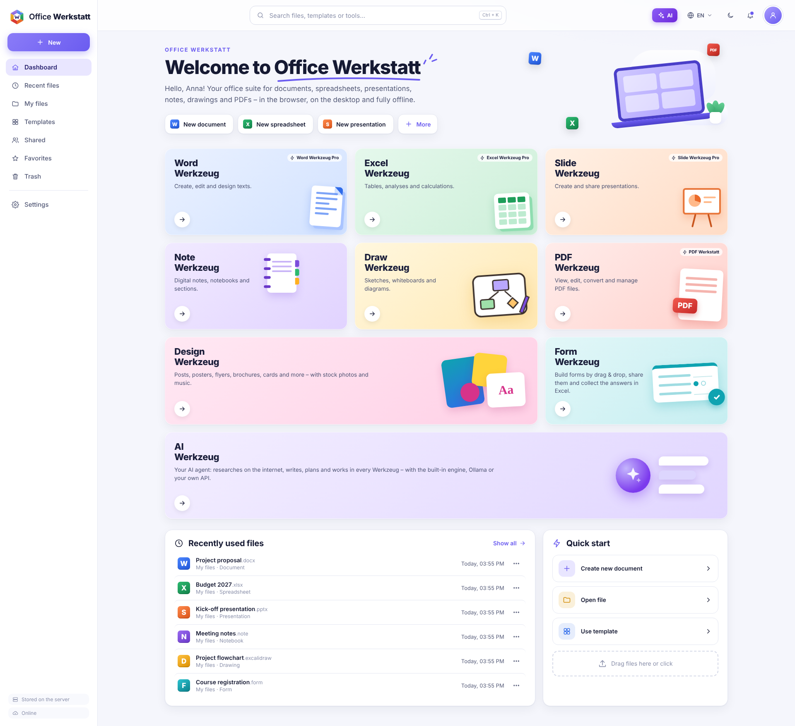
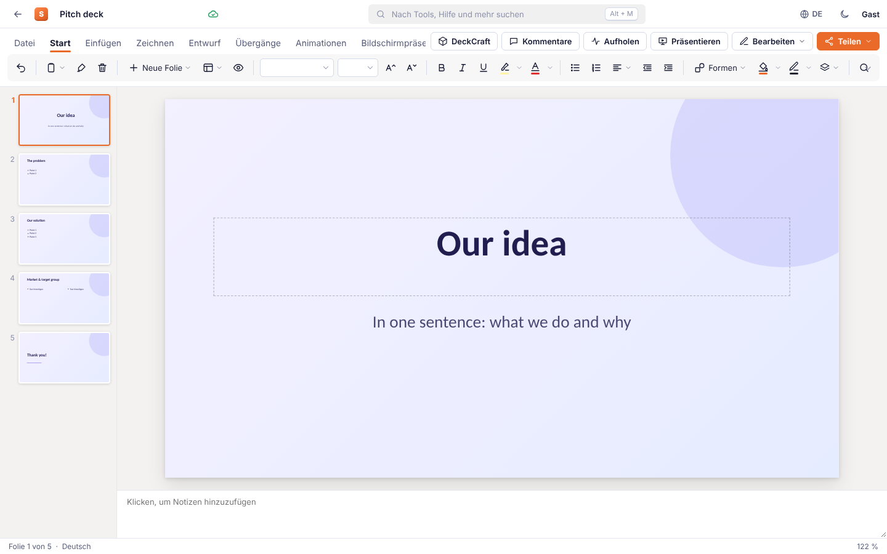
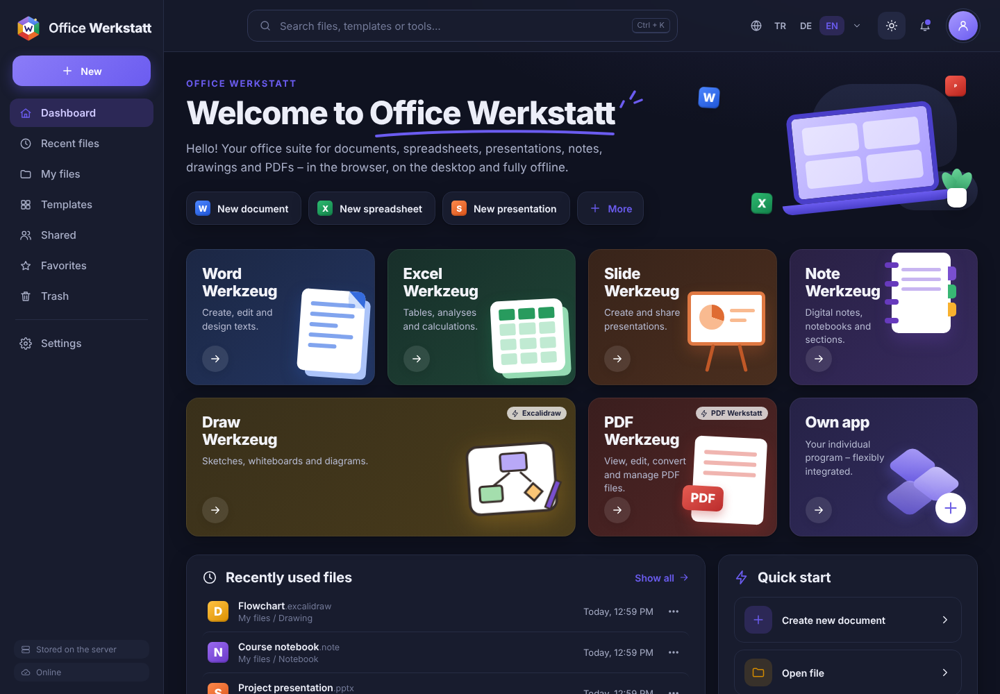
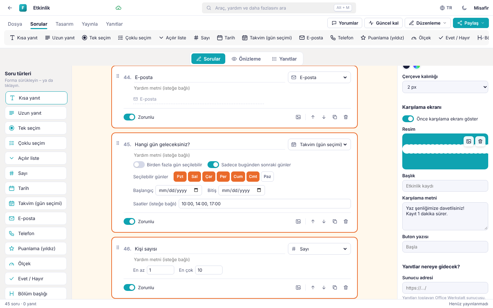
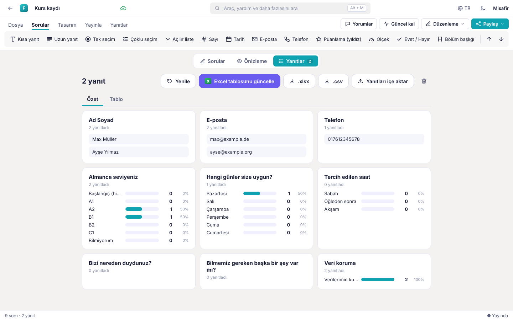

<p align="center">
  
</p>

<h1 align="center">Office Werkstatt</h1>

<p align="center">
  <b>Bütünleşik, internetsiz çalışan ofis paketi</b> – tarayıcıda, masaüstünde ve kendi sunucunuzda.<br>
  Word · Excel · Slide · Note · Draw · PDF · Design · Formular · <b>AI</b> Werkzeug — tek pencerede, yerleşik yapay zekâ ajanıyla.
</p>

<p align="center">
  <a href="https://github.com/smyrna-pergamum/office-werkstatt/releases/latest"><b>⬇ Windows kurulum dosyası (çevrimdışı)</b></a>
  &nbsp;·&nbsp; <a href="#hızlı-başlangıç">Hızlı başlangıç</a>
  &nbsp;·&nbsp; <a href="#özellikler">Özellikler</a>
  &nbsp;·&nbsp; <a href="#yz-ajanı-ai-werkzeug">YZ ajanı</a>
  &nbsp;·&nbsp; <a href="#english">English</a>
  &nbsp;·&nbsp; <a href="#deutsch">Deutsch</a>
</p>

<p align="center">
  
  
  
  
</p>



## Özellikler

| Araç | Düzenleyici |
|---|---|
| **Word Werkzeug** | **Word Werkzeug Pro** (tam motor) — belgeler `.docx` olarak kitaplıkta saklanır |
| **Excel Werkzeug** | **Excel Werkzeug Pro** (tam motor) — `.xlsx`, çoklu sayfa, formüller |
| **Slide Werkzeug** | **Slide Werkzeug Pro** (tam motor) — `.pptx`, yerleşik **OpenDocument** (`.odp .otp .fodp .odg`) kaydetme ve açma, 5 dilli arayüz |
| **Note Werkzeug** | OneNote tarzı: defter → bölüm → sayfa, etiketler, kalem/mürekkep, toplantı şablonu, **takvim** (ay görünümü, etkinlik ↔ sayfa bağlantısı, `.ics` içe/dışa aktarma) |
| **Draw Werkzeug** | Not ve beyin fırtınası panosu (sonsuz tuval): not kartları, yapışkan notlar, şekiller, bağlantılar, zihin haritası, çerçeveler, kalem; klasik şerit; şablonlar; PNG / SVG / `.excalidraw` |
| **PDF Werkzeug** | **PDF Werkstatt** (kırmızı sürüm): düzenleme, OCR, imzalama, koruma, dönüştürme |
| **Design Werkzeug** | Canva tarzı tasarım stüdyosu: sosyal medya gönderileri, afiş, el ilanı, dergi ve kitap kapağı, broşür (iki kırım, Z kırım, sarmal kırım), davetiye, kartvizit, yılbaşı / doğum günü / tebrik kartı, sticker, sertifika, video. 17 şablon, 16 gömülü yazı tipi, marka kiti, çerçeveler, QR kod, sayfalar, animasyon; stok fotoğraf / illüstrasyon / ikon / müzik (Openverse, Iconify, Pexels, Pixabay, Unsplash, Freesound, Jamendo); PNG, JPG, SVG, PDF, baskı PDF'i (taşma payı + kesim işaretleri), müzikli video |
| **AI Werkzeug** | Yerleşik yapay zekâ ajanı: her Werkzeug'da yan panel ve tam sayfa; belge üzerinde çalışır, internette araştırır, yeni belgeler oluşturur (bkz. [YZ ajanı](#yz-ajanı-ai-werkzeug)) |
| **Formular Werkzeug** | Sürükle-bırak form oluşturucu, sınırsız soru, takvimden gün + saat seçimi, resim ve metin blokları, karşılama ekranı, başlık resmi, renk / arka plan / çerçeve, önizleme/kiosk, link + QR kod, yanıtlar → Excel Werkzeug, `.xlsx` / `.csv` |

Pro motorlar kurulu olduğunda Word / Excel / Slide doğrudan bu motorlarda açılır (ayrı bir “basit görünüm” yoktur).
Motorun Kaydet komutu (Ctrl+S) belgeyi Office Werkstatt kitaplığına yazar; kapatırken, dil değişirken ve düzenlemeye ara
verildiğinde otomatik kaydedilir. Motor yoksa yerleşik düzenleyiciler kullanılır.

- **Office tarzı arayüz:** başlık çubuğu, sekmeler (Datei / Start / Einfügen …), şerit, Kommentare, Aufholen, Bearbeiten / Anzeigen, Teilen, Datei arka planı, otomatik kayıt, Alt+M komut araması.
- **Ana sayfa:** karşılama alanı, oluşturma butonları, son dosyalar, hızlı başlangıç, sürükle-bırak yükleme, Ctrl+K arama.
- **Kitaplık:** Dosyalarım, şablon galerisi, Paylaşılanlar, Favoriler, Çöp kutusu (geri yükleme), yedekleme / geri yükleme.
- **5 dil:** Türkçe, Deutsch, English, Español, Français — dil seçimi editör menülerini, tam motorları (Word, Excel, Slide) ve PDF Werkstatt'ı da değiştirir.
- **Açık / koyu tema**, responsive tasarım (masaüstü, tablet, mobil).
- **Eigene App:** kendi web uygulamanızı *Ayarlar → Eigene App* altına ekleyin.
- **Tamamen çevrimdışı:** hiçbir CDN veya harici istek yok. İnternet yalnızca istendiğinde kullanılır: YZ ajanının internet araştırması (Ayarlar'dan kapatılabilir), stok medya ve *Diktieren* (sesle yazdırma).

<table>
<tr><td></td><td></td></tr>
<tr><td></td><td></td></tr>
<tr><td></td><td></td></tr>
</table>

## YZ ajanı (AI Werkzeug)

Her Werkzeug'un başlık çubuğundaki **YZ** düğmesi yanda ajan panelini açar; ana sayfadaki **AI Werkzeug** kartı tam sayfa çalışır.
Panel tek bir **ajandır**: ne istediğinizi yazarsınız, ajan işi kendisi yapar.

**Yapay zekâ motorları** (Ayarlar › Yapay zeka)
- **Yerleşik motor** ([llama.cpp](https://github.com/ggml-org/llama.cpp)) – Ollama veya başka bir program gerekmez. Model listesinden (Qwen 2.5 1.5B / 7B / 14B, Llama 3.2 3B) tek tıkla indirilir; ekran kartı varsa onu, yoksa işlemciyi kullanır. Tamamen internetsiz çalışır.
- **Ollama** (aynı bilgisayarda, `http://127.0.0.1:11434`).
- **OpenAI standardındaki her API** (`/v1/chat/completions`: OpenAI, OpenRouter, Mistral, Groq, LM Studio, vLLM …) – kendi API anahtarınızla.

**Agent Bridge – ajan nasıl çalışır** (tasarım: [`agent-bridge/`](agent-bridge/), uygulamada `public/js/agent-bridge.js`)

```
istek → yapay zekâ → okuma araçları (belge, kitaplık, internet) → değişiklik PLANI
      → doğrulama (izin verilen araçlar, şema) → önizleme → onay → tek işlem (transaction) → geri al
```

- **Okur:** açık belgeyi, kitaplıktaki dosyaları ve **interneti** (arama + sayfa okuma; kaynaklar bağlantı olarak verilir) kendiliğinden okur.
- **Planlar:** belgeye doğrudan dokunmaz; tüm değişiklikleri tek bir plan olarak hazırlar. Yalnızca açık Werkzeug'un araç kaydındaki araçlar kullanılabilir, parametreler her aracın şemasına göre denetlenir; `$result:N` ile önceki adımın sonucu (ör. yeni slaydın kimliği) sonraki adımda kullanılır. En fazla 50 adım.
- **Önizleme ve onay:** plan panelde adım adım gösterilir – *Uygula* / *Reddet* (Ayarlar'dan kapatılabilir).
- **Tek işlem:** onaylanan plan tek seferde uygulanır; bir adım başarısız olursa belge plandan önceki hâline döner. Önizlemeden sonra belge elle değiştirildiyse plan uygulanmaz.
- **Geri al:** bitmiş bir plan *Ajanın değişikliklerini geri al* ile tek adımda geri alınır.
- **Werkzeug'lar:** Word (yazma, stiller, tüm şerit komutları), Excel (hücreler, formüller), Slide (slaytlar, metinler), Note, Draw (yapışkan notlar, zihin haritası), Design, Formular; kitaplıkta yeni Word / Excel / Slide / Note / Formular belgeleri.

**İnternet araştırması:** varsayılan olarak açık (panelde **+ › İnternet araştırması** veya Ayarlar'dan kapatılır).
Arama sırayla isteğe bağlı kendi **SearXNG** sunucunuz, Bing, DuckDuckGo ve Wikipedia ile yapılır – biri yanıt vermezse sıradaki denenir.
İstekler Office Werkstatt sunucusu (`/api/ai/*`) üzerinden gider; yerel ağ adresleri engellenir, web sayfalarındaki metin talimat olarak değil yalnızca veri olarak işlenir.
API anahtarları yalnızca tarayıcıda / masaüstü uygulamasında saklanır ve yalnızca ayarlanan API'ye gönderilir.

## Design Werkzeug

Canva tarzı tasarım stüdyosu: üstte diğer araçlardaki gibi klasik şerit menü, solda *Şablonlar · Öğeler · Metin · Fotoğraflar · İllüstrasyonlar · İkonlar · Ses · Yüklemeler · Marka · Katmanlar · Kaynaklar* paneli, ortada sayfa, altta sayfa şeridi.

- **Formatlar:** Instagram / Facebook / LinkedIn / X / YouTube / Pinterest, afiş A3–A1, el ilanı A4–A6, dergi, kitap kapağı (sırtlı), iki kırımlı / Z kırımlı / sarmal kırımlı broşür, davetiye, katlanır kart, kartpostal, kartvizit, sticker, sertifika, video 16:9 ve 9:16, özel boyut. Baskı formatlarında 3 mm taşma payı, güvenli alan ve kırım çizgileri gösterilir.
- **Dışa aktarma:** PNG, JPG, SVG, PDF standart, **PDF baskı** (300 dpi, taşma payı, kesim işaretleri, TrimBox/BleedBox), sayfa animasyonlu ve müzikli **video** (MP4/WebM).
- **Stok medya:** Openverse ve Iconify anahtarsız çalışır; Pexels, Pixabay, Unsplash, Freesound ve Jamendo için ücretsiz API anahtarı *Ekle → Stok kaynakları* altına girilir. Sunucu modunda anahtarlar `data/stock-keys.json` içinde sunucuda kalır, medya `/api/stock/media` üzerinden alınıp tasarıma gömülür (sonra internetsiz de görünür). Kullanılan her medyanın lisans/kaynak bilgisi *Kaynaklar* panelinde listelenir.
- Tuval motoru: [Fabric.js](http://fabricjs.com) 5.3 (MIT). Yazı tipleri: Fontsource üzerinden OFL lisanslı (bkz. `public/fonts/LICENSE.txt`).

## Formular Werkzeug

Formu sürükle-bırak ile oluşturun (soru sayısı sınırsız; resim, metin bloğu, takvimden gün/saat seçimi, karşılama ekranı, başlık resmi, çerçeve ve arka plan rengi), **Oluştur** deyin – tek dosyalık bir HTML form sayfası çıkar. Yanıtlar otomatik olarak bir **Excel Werkzeug tablosunda** toplanır.

| Kullanım | Nasıl paylaşılır | Yanıtlar nereye gider |
|---|---|---|
| **Sunucu** (internet / yerel ağ) | Link `https://<sunucu>/f/<id>` ve **QR kod** – şifre gerekmez, kişiler sadece bu formu görür | Sunucuya; Excel tablosu her yeni yanıtla kendini günceller |
| **HTML dosyası** (ör. januam.org sitesine) | Sayfayı istediğiniz yere koyun; *Sunucu adresi* girildiyse oraya gönderir (CORS açık) | Sunucuya – sunucuya ulaşılamazsa cihaza kaydeder, bir sonraki açılışta yeniden dener |
| **Kiosk** (tablet / laptop, internetsiz) | Sayfayı cihazda açık bırakın; form her yanıttan sonra kendini sıfırlar | Cihaza; altta *Yanıtları dışa aktar* → *Yanıtlar → İçe aktar* |
| **E-posta yedeği** | Sunucu yoksa “E-posta ile gönder” butonu çıkar | Gelen e-postaları *Yanıtlar → İçe aktar*'a yapıştırın |

Sunucu uç noktaları: `GET /f/<id>` (herkese açık sayfa) · `POST /api/forms/<id>/responses` (herkese açık, doğrulamalı, IP başına dakikada 30 istek – `OW_FORM_RATE`) · `GET/DELETE /api/forms/<id>/responses` ve `PUT/GET/DELETE /api/forms/<id>/publish` (ekip girişi gerekir). Veriler `data/forms/` içinde.

<table><tr><td></td><td></td></tr></table>

## Hızlı başlangıç

### 1 · Windows masaüstü uygulaması
[Releases](https://github.com/smyrna-pergamum/office-werkstatt/releases/latest) sayfasından `Office-Werkstatt-Setup-<sürüm>.exe` dosyasını indirip çalıştırın.
Kurulum **internet ve yönetici hakkı gerektirmez**; masaüstü kısayolu, başlat menüsü kaydı ve
`.docx .xlsx .pptx .pdf .csv .md .excalidraw` için “Birlikte aç → Office Werkstatt” ekler. Belgeler `%APPDATA%\Office Werkstatt` içinde saklanır.

### 2 · Sunucu (ekip / intranet) — Node.js 18+, bağımlılık yok
```bash
node server/server.js                 # http://localhost:8080 — yalnızca bu bilgisayar (127.0.0.1)
# Windows: start-windows.bat   ·   Linux/macOS: ./start.sh
HOST=0.0.0.0 OW_USER=ekip OW_PASS=gizli node server/server.js      # ağda paylaşım: giriş zorunlu
OW_USER=ekip OW_PASS=gizli docker compose up -d                     # veriler ./data içinde
```
**Güvenlik:** Sunucu varsayılan olarak yalnızca `127.0.0.1` adresinde dinler. Ağ adresinde (`HOST=0.0.0.0` vb.) `OW_USER` / `OW_PASS`
olmadan **başlamaz** — aksi hâlde ağdaki herkes tüm belgeleri okuyup değiştirebilirdi. Ağda mutlaka bir HTTPS ters vekil
(Caddy, nginx, Traefik) arkasında çalıştırın; temel kimlik doğrulama şifreyi açık metin gönderir. Yerel modda başka sitelerin
`127.0.0.1`'e yönlendirilmiş alan adlarıyla (DNS rebinding) erişimi engellenir. Belgelerdeki HTML her gösterimde temizlenir
(betik, olay işleyici, `javascript:` bağlantısı çalışmaz).
Sunucu modunda herkes aynı dosyaları görür.
Tarayıcıda adres çubuğundaki **Yükle** simgesiyle uygulama olarak (PWA) kurulabilir.

### 3 · Kurulumsuz
`public/index.html` dosyasına çift tıklayın — belgeler tarayıcıda (IndexedDB) saklanır.

## Derleme

```bash
cd desktop && npm install
npm start                 # geliştirme
npm run dist:win          # → dist/Office-Werkstatt-Setup-<sürüm>.exe (yerel NSIS, Wine gerekmez)
npm run dist:linux        # AppImage    ·    npm run dist:mac → .dmg
```

Tam motorlar `public/engines/` içinde derlenmiş olarak gelir. Yeniden derlemek için (Rust ≥ 1.95, `wasm32-unknown-unknown`, `wasm-bindgen-cli 0.2.129`):
```bash
node scripts/fetch-engines.js            # tüm motorlar
node scripts/fetch-engines.js word pdf   # yalnızca seçilenler
```

## Klasör yapısı
```
public/              web uygulaması (index.html, css/, js/, assets/, manifest, service worker)
  js/editors/        word · excel · slide · note · draw · pdf · design · form · ai
  js/ai.js           YZ ajanı: motorlar, araçlar, panel, ayarlar
  js/agent-bridge.js Agent Bridge: araç kaydı, plan doğrulama, transaction, geri alma
  js/odf.js          OpenDocument sunu (.odp/.otp/.fodp/.odg) okuma/yazma
  js/zip.js          OOXML motoru (.docx/.xlsx/.pptx okuma, .docx/.xlsx/.pptx yazma)
  js/i18n.js         5 dilli sözlük
  js/editors/pro.js  Word/Excel/Slide Werkzeug Pro köprüsü (açma, kaydetme, otomatik kayıt)
  js/sanitize.js     HTML temizleyici (belge içeriği)
  js/desktop.js      masaüstü: yazdırma yönlendirmesi
  engines/           tam motorlar + engines.js + apps.js (Eigene App)
server/server.js     bağımlılıksız Node sunucusu + REST API (/api/files, /api/engines)
server/ai.js         YZ: API köprüsü, web araması, sayfa okuma · server/llm.js: yerleşik llama.cpp motoru
agent-bridge/        Agent Bridge başvuru paketi (V1–V4, testlerle: npm test)
engines-src/         motorların derleme notları ve yamaları (ör. Slide arayüz çevirisi)
desktop/             Electron kabuğu, yazdırma önizlemesi, çevrimdışı NSIS kurulum betiği
scripts/             motor kurulum / derleme betikleri
```

---

## English
**Office Werkstatt** is an integrated, fully offline office suite for the browser, the desktop (Windows/macOS/Linux) and your own server:
Word, Excel, Slide, Note, Draw, PDF, Design, Form and **AI** Werkzeug with an Office-style ribbon, 5 interface languages (TR/DE/EN/ES/FR),
light/dark theme and responsive layout.
The built-in **AI agent** (local llama.cpp engine, Ollama or any OpenAI-compatible API) reads your document, your library and the internet,
prepares every change as a plan of whitelisted tools, shows it for approval and applies it as one transaction that is rolled back on failure
and can be undone in one step (Agent Bridge, see `agent-bridge/`).
Download the offline Windows installer from **Releases**, or run `node server/server.js`.

## Deutsch
**Office Werkstatt** ist eine integrierte Office-Suite, die komplett ohne Internet läuft – im Browser, auf dem Desktop und auf dem eigenen Server:
Word-, Excel-, Slide-, Note-, Draw-, PDF-, Design-, Formular- und **KI**-Werkzeug mit Menüband im Office-Stil, 5 Sprachen, hellem/dunklem Design und responsivem Layout.
Der eingebaute **KI-Agent** (lokale llama.cpp-Engine, Ollama oder jede OpenAI-kompatible API) liest Dokument, Bibliothek und Internet,
plant jede Änderung, zeigt den Plan zur Freigabe und wendet ihn als eine Transaktion an – mit Rücknahme bei Fehlern und Rückgängig in einem Schritt.
Den Offline-Installer für Windows gibt es unter **Releases**; Server-Start mit `node server/server.js`.

## Lisans
Office Werkstatt: [MIT](LICENSE) © Süleyman Akbulut.
Yerleşik motorlar kendi lisanslarını korur; lisans metinleri ilgili klasörlerdedir:
`public/engines/word|excel|slide/LICENSE-*` (MIT veya Apache-2.0), `public/engines/pdf/LICENSE` (AGPL-3.0).
Slide arayüz çevirileri (DE/FR/ES): [storytold/craft-i18n](https://github.com/storytold/craft-i18n) (MIT veya Apache-2.0). Yerleşik YZ motoru: llama.cpp (MIT, lisans metni kurulumla gelir).
PDF Werkstatt içindeki bileşenler (PDF.js, pdf-lib, MuPDF, Tesseract.js …) için `public/engines/pdf/LICENSE`.
